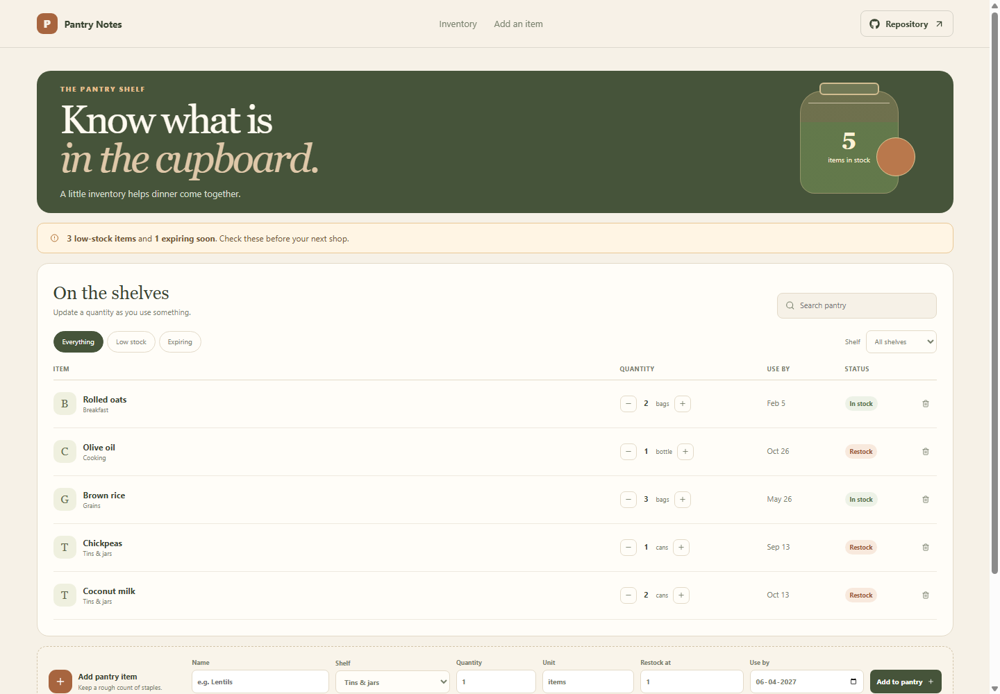

# Pantry Notes: Pantry Inventory Manager

Pantry Notes is a lightweight stock list for shelf staples. It helps you notice items that are nearly out or should be used soon before you plan another shop.

**GitHub Pages URL:** https://a2rp.github.io/pantry-inventory-manager/ (available after deployment)

## Included

- Record an item, shelf, quantity, unit, restock threshold, and use-by date.
- Adjust each count with plus and minus buttons.
- Filter items by shelf, low stock, or items expiring within seven days.
- See low-stock and near-expiry counts above the inventory table.
- Remove stock entries after confirming the named item.

## How to use it

Add staples with an approximate count and a restock threshold. Use the quantity controls when something is used or replenished. Check Low stock and Expiring before shopping.

## Data and limits

Inventory is stored in this browser using localStorage. Counts are manual estimates. Expiry highlighting uses the date entered and is not a food-safety guarantee.

This is a browser-only utility. Clearing the browser’s site data removes its saved information.

## Run locally

~~~sh
npm install
npm run dev
~~~

## Checks and deployment

~~~sh
npm run lint
npm run build
npm run deploy
~~~

The deploy command builds the project and publishes the dist directory to the gh-pages branch. It requires the project’s public GitHub repository to be configured as origin.

## Future improvements

Ideas only. These are not implemented yet:

- Scan product barcodes.
- Create a grocery list from low-stock items.
- Add multiple pantry locations and household sharing.

## Links

- Portfolio: [https://www.ashishranjan.net](https://www.ashishranjan.net)
- GitHub: [https://github.com/a2rp](https://github.com/a2rp)
- CodePen: [https://codepen.io/ash1198](https://codepen.io/ash1198)
- LinkedIn: [https://www.linkedin.com/in/aashishranjan](https://www.linkedin.com/in/aashishranjan)
- Facebook: [https://www.facebook.com/theash.ashish/](https://www.facebook.com/theash.ashish/)
- YouTube: [https://www.youtube.com/@ashishranjan-ashz?sub_confirmation=1](https://www.youtube.com/@ashishranjan-ashz?sub_confirmation=1)
- Email: [mailto:ash.ranjan09@gmail.com](mailto:ash.ranjan09@gmail.com)

## Support

- Support: [https://a2rp-donation-page.netlify.app/](https://a2rp-donation-page.netlify.app/)
- Buy Me a Coffee: [https://buymeacoffee.com/ashishranjan](https://buymeacoffee.com/ashishranjan)
- Patreon: [https://www.patreon.com/ashishranjan](https://www.patreon.com/ashishranjan)